# RDTMD

RDTMD is a standalone, native technical markup language and VS Code extension built entirely from scratch without runtime dependencies or external libraries. It replaces the fragmented Markdown ecosystem by integrating mathematical formulas, interactive charts, nine kinds of structured diagrams, tabbed interfaces, metric dashboards, conversations, footnotes, and modular files into a single, cohesive specification, with one-click export to HTML and PDF.

---

## Table of Contents

1. [Overview and Philosophy](#overview-and-philosophy)
2. [Why RDTMD: Comparison with Markdown](#why-rdtmd-comparison-with-markdown)
3. [The Three Design Principles](#the-three-design-principles)
4. [Syntax Reference](#syntax-reference)
   - [Headings and Typography](#headings-and-typography)
   - [Lists and Checklists](#lists-and-checklists)
   - [Tables](#tables)
   - [Callouts and Quotes](#callouts-and-quotes)
   - [Custom LaTeX Mathematics](#custom-latex-mathematics)
   - [Native SVG Charts](#native-svg-charts)
   - [Native SVG Diagrams](#native-svg-diagrams)
   - [Common Block Options](#common-block-options)
   - [Interactive Tabs](#interactive-tabs)
   - [Unambiguous Metric Cards](#unambiguous-metric-cards)
   - [Conversational Dialogue](#conversational-dialogue)
   - [Collapsible Details](#collapsible-details)
   - [Table of Contents, Anchors and Footnotes](#table-of-contents-anchors-and-footnotes)
   - [Fenced Code Blocks and Syntax Highlighting](#fenced-code-blocks-and-syntax-highlighting)
   - [Modular Document Includes](#modular-document-includes)
5. [Security and CSP Compliance](#security-and-csp-compliance)
6. [AST Architecture](#ast-architecture)
7. [VS Code Extension](#vs-code-extension)
   - [Live Preview and Interactive Figures](#live-preview-and-interactive-figures)
   - [Export to HTML and PDF](#export-to-html-and-pdf)
   - [Themes and Palettes](#themes-and-palettes)
   - [Editing Features](#editing-features)
   - [Settings and Commands](#settings-and-commands)
8. [Installation and Usage](#installation-and-usage)

---

## Overview and Philosophy

Traditional Markdown was designed in 2004 as an email-friendly shorthand for simple HTML prose. Over the past two decades, technical writing and scientific documentation have evolved: researchers and engineers now require complex mathematical notation, interactive code snippets, architectural diagrams, metric tracking, and modular document structures.

To meet these requirements, the industry historically adopted a fragmented approach:
- Wrapping Markdown in non-standard dialects (CommonMark, GFM, MDX, Pandoc).
- Injecting third-party JavaScript runtimes (KaTeX, MathJax, Mermaid, Chart.js, Prism, Highlight.js).
- Concatenating unverified HTML strings that create security hazards and break strict Content Security Policies (CSP).

RDTMD redesigns technical documentation from the ground up:
- **Zero runtime dependencies**: The entire stack (tokenizer, AST parser, LaTeX math layout engine, SVG chart/diagram generators, syntax highlighter, and include resolver) contains zero third-party packages.
- **Pure programmatic DOM/SVG generation**: Never constructs HTML strings (`innerHTML`). Every visual element is assembled via `document.createElement`, `document.createElementNS`, and `element.textContent`, guaranteeing compatibility with locked-down corporate and sandbox environments.
- **Unified grammar**: Charts, diagrams, mathematics, tabs, and metrics exist as first-class citizens within the grammar rather than ad-hoc script injections.

---

## Why RDTMD: Comparison with Markdown

| Feature | Standard Markdown (CommonMark / GFM) | Markdown with Plugins (MDX / Mermaid / KaTeX) | RDTMD |
| :--- | :--- | :--- | :--- |
| **Mathematical Formulas** | Not supported natively. | Requires KaTeX (~300 KB) or MathJax (~2 MB) injected into the DOM. | Native recursive LaTeX engine built from scratch. Zero external assets. |
| **Data Charts** | Not supported. Requires external image generation or static exports. | Requires Chart.js, Vega, or Mermaid. Breaks offline and sandboxed views. | Native SVG rendering (`bar`, `line`, `area`, `scatter`, `pie`, `donut`) with stacking, horizontal bars, a secondary axis, and automatic axis computation. |
| **Architectural Diagrams** | Not supported. | Requires Mermaid.js runtime (~3 MB bundle), prone to CSP blocks. | Native SVG layout algorithms for `flow`, `state`, `sequence`, `mindmap`, `timeline`, `gantt`, `quadrant`, `er`, and `class`. |
| **Tabbed Views** | Not supported. | Requires HTML/JS wrappers or framework-specific MDX components. | Native `:::tabs` block with instant client-side switching and keyboard accessibility. |
| **Metric and KPI Cards** | Not supported. | Hand-crafted HTML `<div>` blocks or external widgets. | Native `:::metrics` grid with explicit polarity controls (`good`, `bad`, `neutral`). |
| **Conversational Transcripts** | Not supported. Standard blockquotes lack role separation. | Custom CSS hacks or proprietary chatbot extensions. | Native `:::chat` block supporting `user`, `assistant`, `system`, and custom agents. |
| **Collapsible Sections** | Dependent on raw `<details>` HTML tags. | HTML tag pass-through with browser-dependent formatting. | Native `:::details` block with animated SVG chevrons and default open states. |
| **Table of Contents and Footnotes** | Footnotes only in some dialects; no table of contents. | Plugins per renderer. | Native `@toc`, heading anchors (`{#id}`), and `[^note]` footnotes. |
| **Code Syntax Highlighting** | Dependent on external highlighters (Prism, Shiki). | Heavy grammars bundled with worker processes. | Built-in tokenizer supporting 25+ languages, line highlights, titles, and copy buttons. |
| **Modular Document Includes** | Not supported in standard specifications. | Ad-hoc build scripts or static-site generator preprocessors. | Native `@include` directive with cycle prevention and depth control. |
| **Export** | Needs a separate converter. | Build pipeline per project. | One command for a self-contained HTML file or a PDF; per-figure SVG and PNG. |
| **Security Architecture** | Prone to XSS via raw HTML pass-through. | High risk when executing arbitrary script tags. | Strict CSP compliant: no `innerHTML`, no `eval`, no inline styles. |

---

## The Three Design Principles

RDTMD adheres to three strict architectural rules to guarantee predictability for both human authors and LLM/AI code assistants:

### 1. Predictable Syntax and Nesting
Nested directives must never break the parser. RDTMD introduces variable-length colon fences (`::::tabs`, `::::details`) and depth tracking. Fenced code blocks containing `:::` or `===` within tabs or directives are safely ignored during directive boundary detection.

### 2. Legible Plain-Text Fallback
A technical document must remain readable in terminal environments, headless git viewers, and raw text editors without any graphical renderer. RDTMD syntax mirrors structured human notes:
- Tabs are demarcated by `=== Tab Title`.
- Metrics are written as `Label: Value (Change)`.
- Conversations follow standard transcript formatting (`user: Hello`).
- Diagrams read like their own outline (`A -> B : label`, `section Phase 1`, `Task: 2026-10-01, 5d`).
The AST also includes a built-in `plainText()` serializer that converts any document into clean, human-readable prose.

### 3. Unambiguous Data Semantics
In machine learning and systems engineering, numerical variations are context-dependent:
- A +2.1% increase in inference throughput is an improvement.
- A +2.1% increase in latency or validation loss is a regression.
RDTMD avoids naive heuristic assumptions. In metric blocks, authors can explicitly declare directional semantics (`(+5 ms, bad)`, `(-12%, good)`, `(+1, neutral)`) to prevent misleading colorations.

---

## Syntax Reference

### Headings and Typography

```rdtmd
# Heading 1
## Heading 2
### Heading 3
#### Heading 4
##### Heading 5
###### Heading 6

Text can be formatted with **bold**, *italic*, ~~strikethrough~~, or `inline code`.
Automatic link parsing: https://example.org or formatted [Link Text](https://example.org "Optional Title").
Images: 

---
```

### Lists and Checklists

RDTMD supports nested unordered lists, ordered lists with custom start offsets, and styled task checklists. Task boxes are rendered as scalable SVG vectors rather than OS-dependent form controls.

```rdtmd
- Top level item
  - Indented nested item
  - Another nested item
- Regular list item

1. First sequential step
2. Second sequential step

- [x] Completed task item
- [ ] Pending task item
```

### Tables

Tables support column alignment syntax (`:---` for left, `:---:` for center, `---:` for right), escaped pipe characters (`\|`), inline code, and math. Rendered tables feature rounded exterior borders, cell borders, and contrast headers.

```rdtmd
| Model Name | Parameters | Context Length | Open Weights |
|:-----------|:----------:|---------------:|:------------:|
| Mistral-7B | 7B         | 32k            | Yes          |
| LLaMA-3-8B | 8B         | 8k             | Yes          |
| Gemini Pro | Unknown    | 1000k          | No           |
```

### Callouts and Quotes

Standard blockquotes use `>`. In addition, RDTMD provides four semantic callout blocks (`note`, `tip`, `warn`, `danger`) styled with accent bars and header badges.

```rdtmd
> Standard multi-line quote
> continuing on the second line.

:::note Important Consideration
Callouts support arbitrary nested blocks, including lists and formulas.
:::

:::tip Optimization Tip
Use INT8 quantization to cut memory consumption in half.
:::

:::warn Resource Limit
Running this model on GPU requires at least 16 GB of VRAM.
:::

:::danger Critical Alert
Do not deploy without setting authentication tokens.
:::
```

### Custom LaTeX Mathematics

The mathematical engine parses LaTeX grammar directly into a specialized DOM tree without external JavaScript or web fonts. It handles baseline alignments, horizontal vinculums, dynamic parentheses scaling, and multi-line matrices.

Inline math uses `$formula$`. Display math blocks use `$$`:

```rdtmd
Inline formula: $E = mc^2$ and $P(A \mid B) = \frac{P(B \mid A)P(A)}{P(B)}$.

$$
\sum_{i=1}^{n} i = \frac{n(n+1)}{2}
$$

$$
\int_0^{\infty} e^{-x^2}\,dx = \frac{\sqrt{\pi}}{2}
$$
```


#### Supported Mathematical Features

- **Arithmetic and Algebra**: Fractions (`\frac{a}{b}`), square roots (`\sqrt{x}`), nth roots (`\sqrt[n]{x}`), superscripts (`x^2`), subscripts (`x_i`), dual indices (`x_i^2`).
- **Calculus and Limits**: Integrals (`\int`, `\oint`), limits (`\lim_{x \to 0}`), products (`\prod`), sums (`\sum`).
- **Matrices and Brackets**:
  ```rdtmd
  $$
  A = \begin{pmatrix} a & b \\ c & d \end{pmatrix}, \quad B = \begin{bmatrix} 1 & 0 \\ 0 & 1 \end{bmatrix}
  $$
  ```
- **Piecewise Functions (Cases)**:
  ```rdtmd
  $$
  f(x) = \begin{cases} x & x > 0 \\ 0 & \text{otherwise} \end{cases}
  $$
  ```
- **Modern Machine Learning Operators**: Built-in support for `\softmax`, `\sigmoid`, `\diag`, `\tr`, `\argmax`, `\argmin`, `\top` ($W^\top x$), `\mid` ($P(A \mid B)$), and `\to` / `\tos`.

### Native SVG Charts

Charts are declared via `:::chart <type> "Title"`. Types are `bar`, `line`, `area`, `scatter`, `pie`, and `donut`. All charts are rendered as clean, scalable vector graphics with automatic coordinate mapping, gridlines, legends, dynamic axis label spacing, and automatic X-axis label rotation when categories are dense.

| Option | Applies to | Effect |
| :--- | :--- | :--- |
| `@unit text` | all | Unit shown above the (left) axis. |
| `@stack` | `bar`, `area` | Stack the series instead of grouping them. |
| `@horizontal` | `bar` | Horizontal bars; categories run down the left side. |
| `@y2 Series, Series` | `bar`, `line`, `area` | Plot the named series on a secondary right-hand axis. In a `bar` chart they are drawn as lines. |
| `@unit2 text` | with `@y2` | Unit of the right-hand axis. |
| `@xlabel text`, `@ylabel text` | cartesian charts | Axis titles. |
| `@center text` | `donut` | Text in the hole; a vertical bar starts a new line. |

The series on a chart with an `x:` line must have exactly as many values as there are categories; the editor flags a mismatch and offers a one-click fix.

#### Bar Chart
```rdtmd
:::chart bar "Monthly Revenue"
@unit kUSD
x: Jan, Feb, Mar, Apr, May, Jun, Jul, Aug, Sep, Oct, Nov, Dec
2025: 12, 18, 9, 22, 16, 25, 20, 14, 28, 30, 35, 42
2026: 15, 21, 14, 30, 22, 32, 28, 19, 34, 38, 45, 50
:::
```

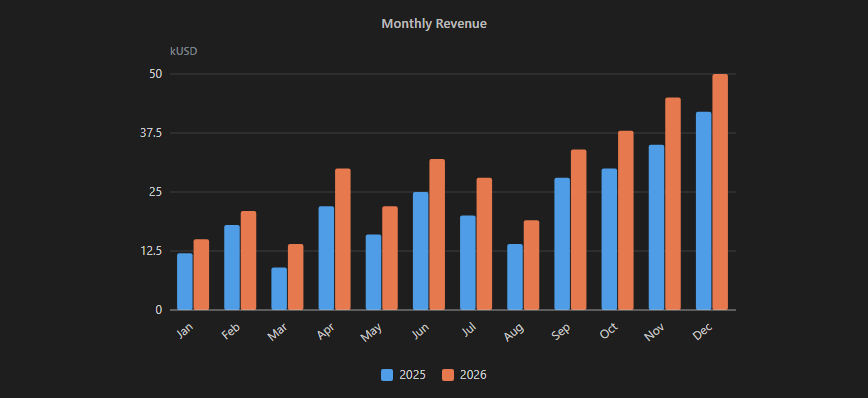

#### Stacked and Horizontal Bars
```rdtmd
:::chart bar "Memory by Language"
@stack
@unit MB
x: Jan, Feb, Mar, Apr
Python: 12, 18, 9, 22
Rust: 7, 5, 14, 8
JS: 4, 9, 6, 11
:::
```

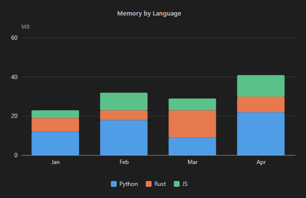

```rdtmd
:::chart bar "Time per Stage"
@horizontal
@unit ms
Parser: 12
SVG render: 48
HTML export: 31
Highlighting: 19
:::
```

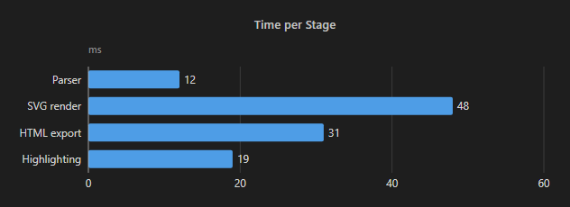

#### Line Chart
```rdtmd
:::chart line "Inference Latency by Batch Size"
@unit ms
x: Batch 1, Batch 2, Batch 4, Batch 8, Batch 16
FP16: 12, 15, 22, 38, 70
INT4: 6, 8, 11, 19, 34
:::
```

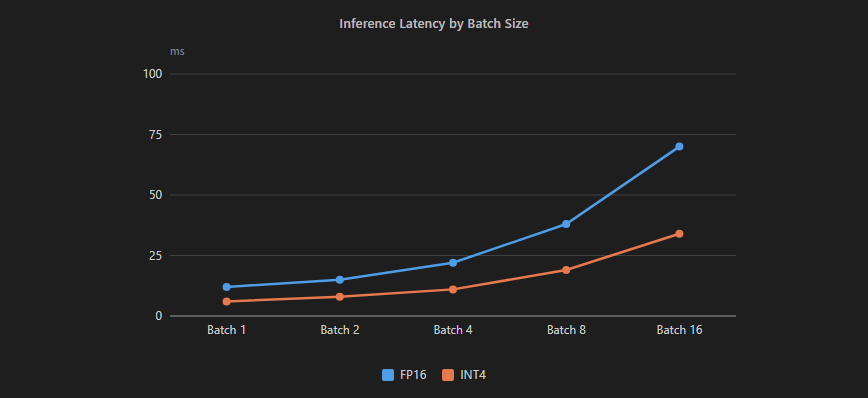

#### Secondary Axis
```rdtmd
:::chart bar "Traffic and Latency"
@unit Requests
@unit2 ms
@y2 Latency
x: Mon, Tue, Wed, Thu, Fri
Requests: 120, 180, 150, 210, 170
Latency: 42, 55, 48, 71, 52
:::
```

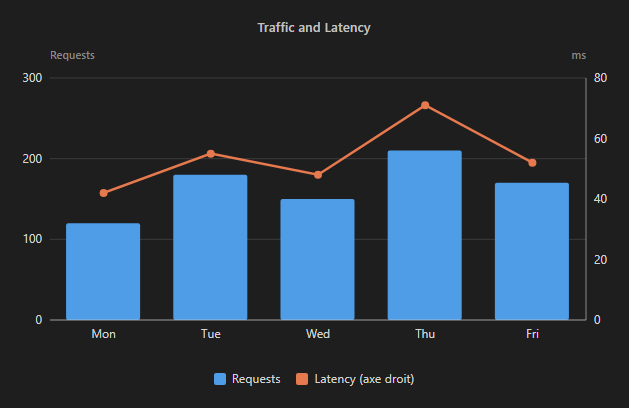

#### Area Chart
```rdtmd
:::chart area "Load by Team"
@stack
x: Q1, Q2, Q3, Q4
Backend: 10, 14, 12, 18
Frontend: 6, 9, 11, 7
:::
```

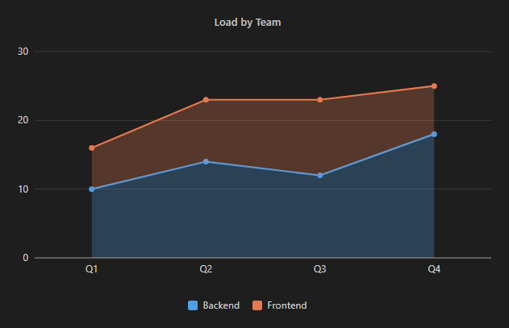

#### Scatter Plot
Each series is a list of `(x, y)` points.

```rdtmd
:::chart scatter "File Size vs Render Time"
@xlabel Size (KB)
@ylabel Time (ms)
Small: (1, 2) (2, 3.5) (3, 4.1) (4, 6)
Large: (8, 14) (10, 19) (12, 22) (9, 15)
:::
```

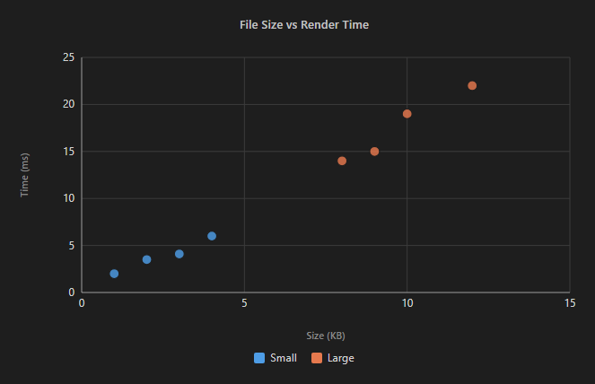

#### Pie and Donut Charts
```rdtmd
:::chart pie "Language Distribution"
Python: 55
Rust: 25
JavaScript: 15
C++: 5
:::
```

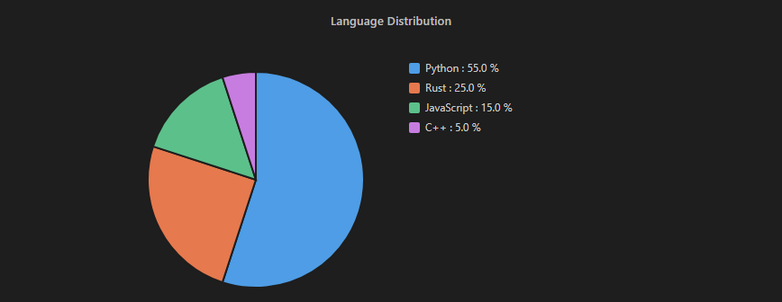

```rdtmd
:::chart donut "Time Split"
@center 100 %
Code: 55
Tests: 25
Docs: 20
:::
```

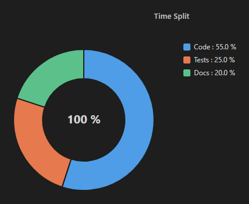

### Native SVG Diagrams

RDTMD ships nine diagram generators with client-side layout algorithms: `flow`, `state`, `sequence`, `mindmap`, `timeline`, `gantt`, `quadrant`, `er`, and `class`. Every diagram sizes itself from the measured text, never overlaps its own labels, and can be hovered, zoomed, and saved as SVG or PNG (see [Live Preview and Interactive Figures](#live-preview-and-interactive-figures)).

#### 1. Flowchart (`flow`)
Computes topological levels using a longest-path algorithm, handles internal cycles gracefully without infinite recursion, orders siblings via predecessor barycenters to minimize edge crossings, and draws curved connecting vectors with directional arrows. Node boxes are sized from the measured text, and the spacing between levels grows with the width of the edge labels, so a label never hides an arrow or a node. Labels are placed without collisions, and back edges (cycles) are routed around the nodes.

```rdtmd
:::diagram flow "Inference Pipeline"
@dir LR
Input -> Tokenizer
Tokenizer -> Embedding
Embedding -> Transformer
Transformer -> LMHead : Logits
LMHead -> Sampler
Sampler --> Output
:::
```

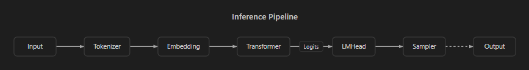

- Direction can be set to `@dir LR` (left-to-right, default) or `@dir TD` (top-to-bottom).
- Solid arrows: `->`. Dashed arrows: `-->`. Edge annotations: `: label` (on the last arrow of a chain).
- Chains work: `Input -> Processor -> Storage` creates two edges.

**Node shapes.** Write the shape right after the id, with no space before the bracket. Plain text is a rectangle.

| Syntax | Shape |
| :--- | :--- |
| `id[Label]` | Rectangle |
| `id(Label)` | Rounded |
| `id{Label}` | Diamond (decision) |
| `id((Label))` | Circle |
| `id[(Label)]` | Cylinder (database) |
| `id{{Label}}` | Hexagon |

```rdtmd
:::diagram flow "Order Validation"
Start((Begin)) -> Check{In stock?}
Check -> Pay(Payment) : yes
Check -> Wait[Waiting] : no
Wait --> Check : retry
Pay -> Db[(Database)] -> Ship{{Shipping}}
Ship -> Done((End))
:::
```

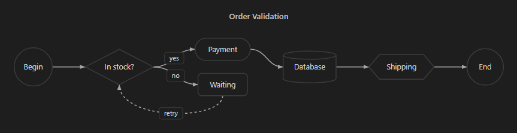

**Groups.** `group Name` ... `end` draws a titled frame around the nodes first mentioned inside it. Groups can be nested.

```rdtmd
:::diagram flow "Architecture"
group Frontend
UI[Interface] -> Router
end
group Backend
API -> Auth
API -> Db[(PostgreSQL)]
end
Router -> API : HTTPS
Auth --> Db
:::
```

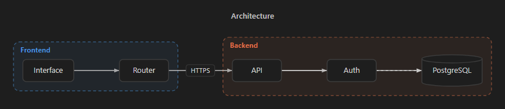

#### 2. State Machine (`state`)
Same syntax as `flow`, plus `[*]` for the initial and final states. The default direction is top-to-bottom.

```rdtmd
:::diagram state "Task Lifecycle"
[*] -> Waiting
Waiting -> Running : start
Running -> Waiting : pause
Running -> Done : finish
Done -> [*]
:::
```

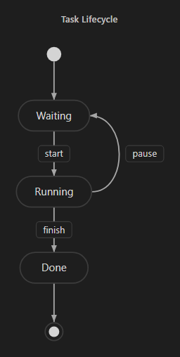

#### 3. Sequence Diagram (`sequence`)
Generates vertical actor lifelines, synchronous calls, dashed return messages, and self-referential loops. The distance between two lifelines adapts to the labels that cross it, and each label has its own background so that a lifeline never strikes through the text.

```rdtmd
:::diagram sequence "Authentication Flow"
Client -> Gateway : POST /login
Gateway -> AuthServer : ValidateToken
AuthServer -> DB : LookupUser
DB --> AuthServer : UserRecord
AuthServer --> Gateway : 200 JWT
Gateway --> Client : Set-Cookie
:::
```

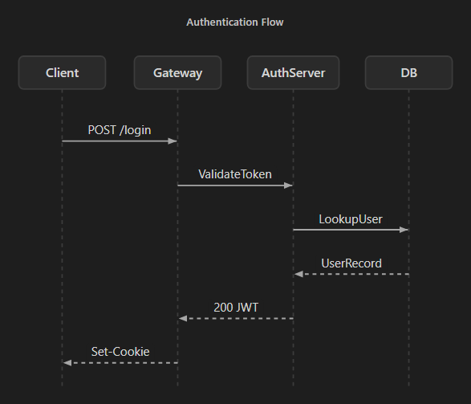

Additional statements, one per line:

| Statement | Effect |
| :--- | :--- |
| `participant Name as Label` / `actor Name` | Declare a participant (fixes the order, sets a display label). |
| `activate Name` / `deactivate Name` | Draw an activation bar on a lifeline. |
| `note over A,B : text` | Note spanning one or two participants. |
| `note left of A : text` / `note right of A : text` | Note beside a lifeline. |
| `alt cond` ... `else cond` ... `end` | Alternative branches. |
| `opt cond` ... `end` | Optional block. |
| `loop cond` ... `end` | Loop. |
| `par label` ... `and label` ... `end` | Parallel branches. |
| `@autonumber` | Number the messages. |

```rdtmd
:::diagram sequence "Authentication"
@autonumber
participant UI as Browser
participant API
participant DB
UI -> API : POST /login
activate API
API -> DB : SELECT user
DB --> API : row
note over API,DB : password hashed with bcrypt
alt valid credentials
API --> UI : 200 + JWT
else invalid credentials
API --> UI : 401
end
deactivate API
loop every 5 min
UI -> API : GET /refresh
end
:::
```

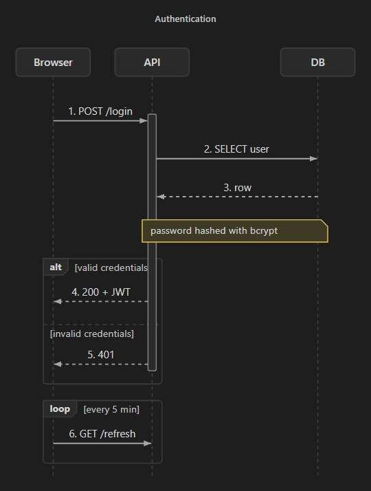

#### 4. Mindmap (`mindmap`)
Parses indentation hierarchies (2 spaces per level, no depth limit) and generates a central-root tree structure. Child branches are balanced across the left and right sides according to their number of leaves, with Bézier curves and distinct branch colors. Click a node to collapse or expand its branch. End a line with `{#hex}` or `{colorname}` to color a branch and everything under it.

```rdtmd
:::diagram mindmap "RDTMD Ecosystem"
RDTMD
  Parser
    AST Schema
    Diagnostics
  Renderer
    Math Engine
    SVG Visuals
  VS Code
    Live Preview
    Language Grammar
:::
```

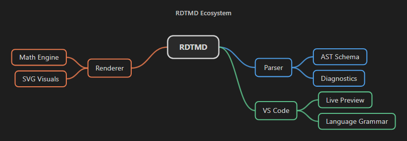

```rdtmd
:::diagram mindmap "Ecosystem"
RDTMD
  Parser {#e6794e}
    Blocks
      Directives
      Includes
    Inline
  Renderer {#4e9de6}
    SVG
    Math
  Extension {#5cc08a}
    Preview
    Export
:::
```

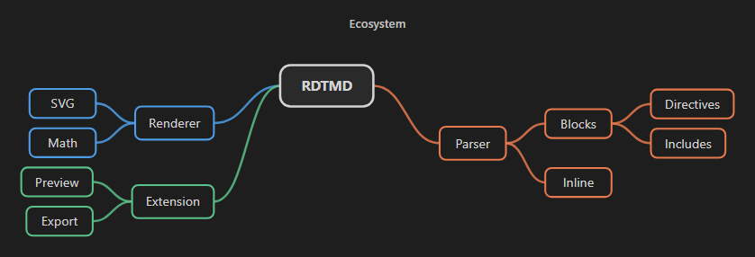

#### 5. Timeline (`timeline`)
Constructs chronological roadmaps. Milestone cards alternate above and below the central temporal axis, supporting multiple concurrent milestones separated by ` | `. Long texts are wrapped inside their card, and cards are sized from the measured text so that nothing overflows or overlaps.

```rdtmd
:::diagram timeline "Project Roadmap"
2024: Architecture design | Initial parser
2025: Native math engine | SVG diagram algorithms
2026: RDTMD v1.1 release | Gantt & quadrant
:::
```

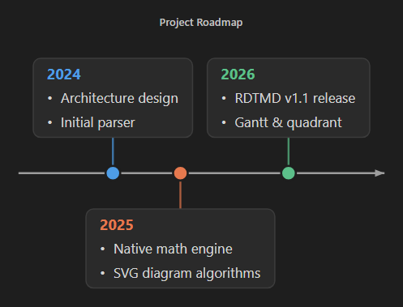

`section Name` groups the following periods and gives them their own color (with a legend). `@orient vertical` lays the timeline out top-to-bottom.

```rdtmd
:::diagram timeline "Roadmap"
@orient vertical
section Past
2024: First prototype
2025: Public release | Marketplace
section Future
2026: Version 1.1 with new diagrams
:::
```

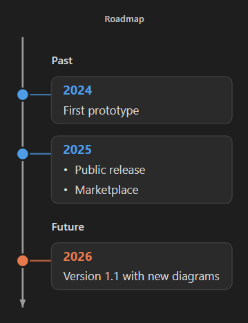

#### 6. Gantt Chart (`gantt`)
One task per line: `Name: [flags,] start[, duration or end]`.

- **Start**: a date `YYYY-MM-DD`, or `after Task` (a task defined earlier). Omit it to start right after the previous task.
- **Duration**: `5d` (days) or `2w` (weeks); or an end date (inclusive).
- **Flags**: `done`, `active`, `crit`, `milestone` (a single-day diamond).
- `section Name` groups tasks. `@today` draws a line at the current date.

```rdtmd
:::diagram gantt "Release Plan"
section Design
Specification: done, 2026-10-01, 5d
Mockups: done, after Specification, 4d
section Build
Parser: active, 2026-10-08, 10d
Rendering: after Parser, 2w
HTML export: crit, 2026-10-20, 8d
section Ship
Tests: 2026-11-01, 6d
Release: milestone, after Tests
:::
```

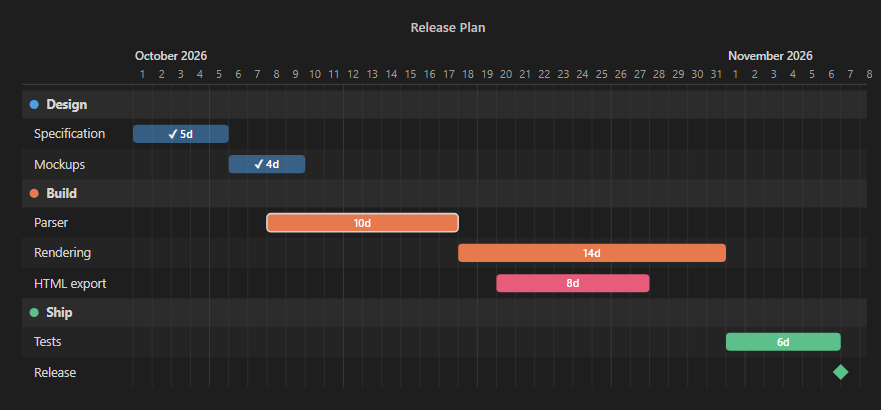

#### 7. Quadrant (`quadrant`)
A four-cell matrix for prioritization. Points use coordinates from 0 to 1 (`x` left to right, `y` bottom to top). `@quadrants` names the cells in the order top-left, top-right, bottom-left, bottom-right.

```rdtmd
:::diagram quadrant "Idea Prioritization"
@x Effort: Low -> High
@y Impact: Low -> High
@quadrants Plan | Major projects | Quick wins | Avoid
PDF export: 0.25, 0.85
Gantt: 0.55, 0.8
Themes: 0.2, 0.3
Collaboration: 0.9, 0.9
Snippets: 0.15, 0.65
:::
```

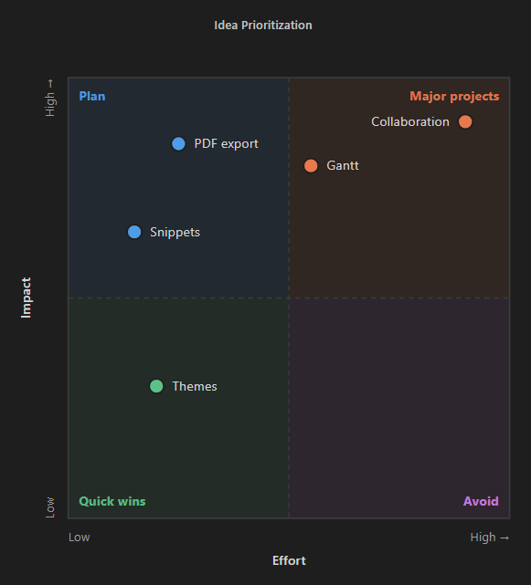

#### 8. Entity-Relationship (`er`)
`entity Name` followed by indented attributes (`name: type`, optionally ending with `PK`, `FK`, or `UK`). Relations are `A <card>--<card> B : label` with the cardinalities `1`, `0..1`, `*`, `1..*`, and `0..*`, drawn with crow's-foot notation.

```rdtmd
:::diagram er "Database Schema"
entity User
  id: int PK
  email: text UK
  org_id: int FK
entity Org
  id: int PK
  name: text
entity Post
  id: int PK
  user_id: int FK
  title: text
Org 1--* User : employs
User 1--0..* Post : writes
:::
```

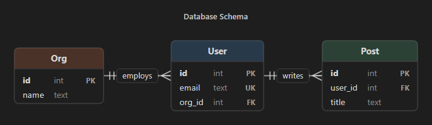

#### 9. Class Diagram (`class`)
`class Name` (optionally `<<stereotype>>`) followed by indented members; members containing `(` are shown as methods. Parents and containers are placed above their children.

| Relation | Meaning |
| :--- | :--- |
| `A --\|> B` or `B <\|-- A` | Inheritance |
| `A ..\|> B` | Realization |
| `A *-- B` or `B --* A` | Composition (A owns B) |
| `A o-- B` or `B --o A` | Aggregation |
| `A --> B` | Association |
| `A ..> B` | Dependency |
| `A -- B` / `A .. B` | Plain / dotted link |

```rdtmd
:::diagram class "Class Hierarchy"
class Animal <<abstract>>
  +name: string
  +age: int
  +speak()
class Dog
  +fetch()
class Cat
  +purr()
class Owner
  +pets: Animal[]
Dog --|> Animal
Cat --|> Animal
Owner o-- Animal : owns
:::
```

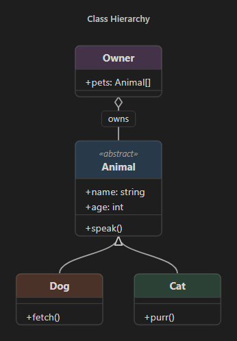

### Common Block Options

Every chart and diagram accepts three options on their own line:

| Option | Values | Effect |
| :--- | :--- | :--- |
| `@theme name` | `default`, `warm`, `cool`, `mono`, `pastel`, `vivid` | Color palette of the block. |
| `@width px` | 120 to 4000 | Maximum width of the figure. |
| `@align side` | `left`, `center`, `right` | Alignment of the figure. |

### Interactive Tabs

The `:::tabs` directive provides instant client-side tab switching without reloading or manipulating query parameters. Each tab begins with `=== Tab Name`. Any valid RDTMD block (code blocks, tables, math, charts, diagrams, callouts) can be placed inside a tab.

```rdtmd
:::tabs
=== Python
```python
def forward(x):
    return self.layer(x)
```
=== JavaScript
```javascript
function forward(x) {
    return this.layer.run(x);
}
```
=== Rust
```rust
fn forward(&self, x: &Tensor) -> Tensor {
    self.layer.forward(x)
}
```
:::
```

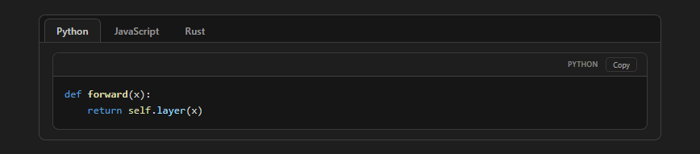

### Unambiguous Metric Cards

The `:::metrics` (or `:::kpi`) block creates responsive KPI grids. Variations can be enriched with explicit polarity qualifiers so improvements and regressions are categorized correctly:

```rdtmd
:::metrics "Benchmark Evaluation"
Validation Loss: 0.18 (-14%, good)
Latency: 42 ms (+6 ms, bad)
Accuracy: 98.4% (+1.2%, pos)
Parameters: 7B (+1B, neutral)
:::
```

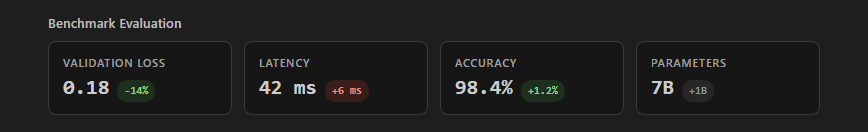

- **Positive / Improvement** (`diff-pos`, green badge): `good`, `pos`, `amelioration` (or prefix `good: -14%`).
- **Negative / Regression** (`diff-neg`, red badge): `bad`, `neg`, `regression` (or prefix `bad: +6 ms`).
- **Neutral** (`diff-neutral`, gray badge): `neutral`, `neutre` (or prefix `neutral: +1B`).
- **Default**: Without a qualifier, leading `+` defaults to positive, and `-` defaults to negative.

### Conversational Dialogue

The `:::chat` (or `:::dialog`) block renders human-to-AI or multi-agent conversations with avatar badges, sender tags, and styled chat bubbles.

```rdtmd
:::chat "Technical Consultation"
user: How can we reduce inference latency while keeping perplexity intact?
ia: You can implement structured INT8 quantization or speculative decoding with a draft model.
system: Benchmark session concluded
:::
```

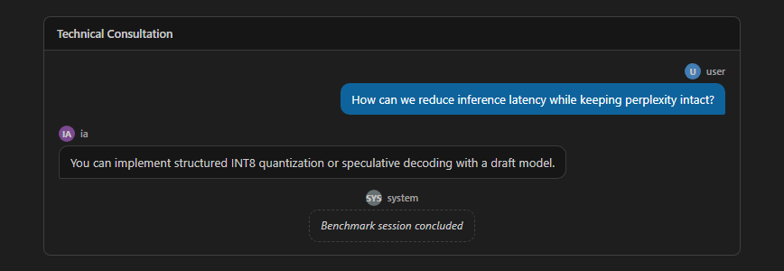

Recognized roles:
- `user`, `utilisateur`, `human`, `me` -> Right-aligned user bubble.
- `ia`, `ai`, `assistant`, `model`, `bot` -> Left-aligned assistant bubble.
- `system`, `systeme` -> Centered italicized system badge.
- Any custom sender name is supported and labeled.

### Collapsible Details

The `:::details` (or `:::accordion`) block provides collapsible disclosure sections with an animated rotating vector chevron.

```rdtmd
:::details "Training Hyperparameters" @open
- **Optimizer**: AdamW (beta1=0.9, beta2=0.999)
- **Base learning rate**: 3e-4 with cosine decay
- **Global batch size**: 128
- **Precision**: Mixed FP16 / BF16
:::
```

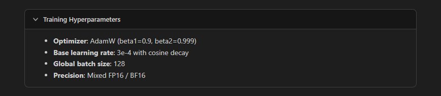

- An optional `@open` parameter renders the section expanded by default.

### Table of Contents, Anchors and Footnotes

```rdtmd
# Release Notes {#top}

@toc 2

## Highlights

RDTMD 1.1 adds nine diagram types, export to HTML and PDF, themes, and footnotes[^1].
See [the charts](#charts) for the details.

[^1]: Footnotes are numbered in order of first citation.
```

- `@toc` inserts a table of contents built from the headings of the document (the optional number is the deepest level, default 3).
- `{#id}` at the end of a heading gives it a stable anchor; without it the anchor is derived from the title (accents and punctuation removed, duplicates numbered). Link to it with `[text](#id)`.
- `[^id]` cites a footnote and `[^id]: text` defines it (indent the following lines to continue it). Notes are numbered by first citation and collected at the end of the document, each with a link back to the text. The editor reports citations without a definition and definitions that are never cited.

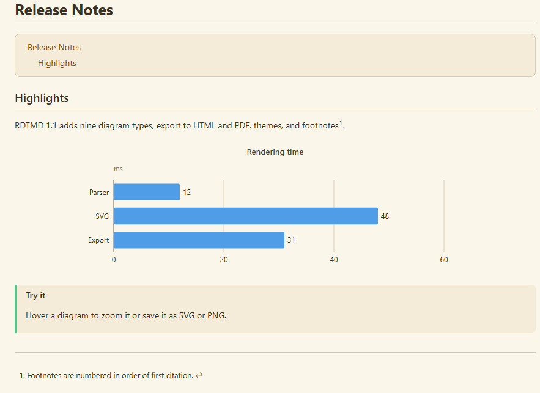

### Fenced Code Blocks and Syntax Highlighting

Code blocks include enhanced headers displaying the language tag, file name, line numbering, line highlighting, and a one-click copy button:

````rdtmd
```python title="train.py" lines hl="2,4-5"
import torch
import torch.nn as nn

class LinearModel(nn.Module):
    def __init__(self):
        super().__init__()
```
````

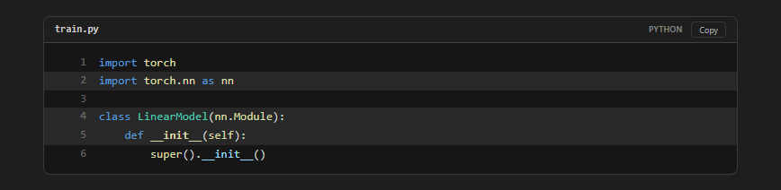

#### Code Fence Metadata Options
- `title="filename.ext"`: Displays the file name in the header bar.
- `lines` or `num`: Activates line numbers.
- `hl="3,5-7"`: Highlights the specified line numbers and ranges.
- Language alias: ```` ```py:train.py ```` is also supported as a concise shorthand.

#### Custom Syntax Tokenizer
The built-in tokenizer recognizes 25+ programming languages, CLI utilities, and config formats:
- **Languages**: Python, JavaScript, TypeScript, Rust, C, C++, C#, Java, Go, PHP, Ruby, Kotlin, Swift, Lua, PowerShell, Batch, Shell, SQL, R, Perl, LaTeX.
- **Config / Data**: JSON, YAML, TOML, INI, HTML, XML, Nginx, GraphQL, Dockerfile, Makefile, Regex, Diff.
- **Diff Enhancements**: Multi-line diff blocks automatically compute outer boundary radiuses, keeping interior line seams square while rounding exterior corners.

````rdtmd
```diff title="version_bump.diff"
@@ -1,4 +1,5 @@
-const version = "1.0.3";
+const version = "1.1.0";
+// Gantt, quadrant, ER and class diagrams
```
````

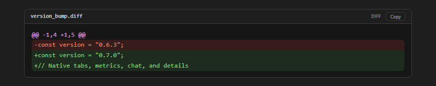

### Modular Document Includes

The `@include` directive embeds external `.rdtmd` documents cleanly:

```rdtmd
@include chapters/introduction.rdtmd
@include architecture/diagrams.rdtmd
```
- **Relative Path Resolution**: Resolves target files relative to the current file on disk.
- **Cycle Detection**: Automatically flags and halts recursive loops.
- **Depth Limiting**: Clamps recursion to a maximum depth of 8 levels.
- **Image Localization**: Automatically remaps relative image paths within included documents to absolute system paths.

---

## Security and CSP Compliance

Many VS Code markdown preview extensions encounter security warnings or rendering failures when strict Content Security Policies (CSP) are enforced in enterprise environments.

RDTMD is designed to adhere to the strictest CSP constraints:
- **No `innerHTML`**: Code paths never assign raw string templates to `element.innerHTML`.
- **No `eval()` or dynamic scripts**: Calculations and layouts execute through pure arithmetic routines.
- **No inline style attribute assignments**: Elements avoid `setAttribute('style', ...)` in favor of direct property manipulation (`element.style.width`) or CSS utility classes.
- **Safe URI validation**: Links beginning with `javascript:`, `vbscript:`, or malicious `data:` schemes are blocked at the inline parser stage.
- **Safe exports**: The document data embedded in an exported HTML file is escaped so that no text, however hostile, can close the surrounding script tag; images are embedded as `data:` URIs and nothing is loaded from the network.

---

## AST Architecture

The RDTMD core exports two primary methods:
- `parse(text)`: Transforms a raw string into an Abstract Syntax Tree (AST) alongside an array of diagnostic warnings or errors. Each diagnostic has a `line`, a `severity`, a `message`, and, when relevant, a machine-readable `code` and `data` used by the editor's quick fixes.
- `plainText(ast)`: Serializes the AST into plain text for fallback display, indexing, or search.

### AST Node Example
```json
{
  "type": "root",
  "children": [
    {
      "type": "heading",
      "level": 1,
      "inline": [{ "type": "text", "value": "Model Architecture" }],
      "line": 0
    },
    {
      "type": "metrics",
      "title": "Performance Summary",
      "items": [
        {
          "label": "Throughput",
          "value": "120 tokens/s",
          "diff": "+15 tokens/s",
          "diffType": "pos",
          "line": 3
        }
      ],
      "line": 2
    }
  ]
}
```

---

## VS Code Extension

### Live Preview and Interactive Figures

**RDTMD: Open Preview** opens a live preview next to the editor. It updates as you type, and the editor and the preview stay scrolled to the same place (`rdtmd.syncScroll`).

Every chart and diagram shows a small toolbar when you hover it:
- **Zoom and pan** (diagrams): `+`, `-`, reset, `Ctrl` + mouse wheel, drag when zoomed, double-click to reset.
- **Highlight on hover**: pointing at a node (or a participant, or a task) dims the rest and keeps its links lit.
- **Collapse**: click a mindmap node to fold or unfold its branch.
- **Save as SVG or PNG**: the file is self-contained (styles are embedded), PNG is rendered at twice the size.

### Export to HTML and PDF

- **RDTMD: Export as HTML** writes a single self-contained `.html` file: styles, scripts, data, and local images are embedded, includes are expanded, and nothing is fetched from the network. It follows the system light/dark preference unless `rdtmd.theme` forces a theme, and the figure toolbar still works in the exported page.
- **RDTMD: Export as PDF** prints the document with a Chromium-based browser found on your machine (Microsoft Edge, Google Chrome, Chromium, or Brave; set `rdtmd.browserPath` to choose one). The PDF uses a light theme (or `paper`), shows every tab, keeps figures together with their captions, and avoids splitting tables and code blocks across pages. If no browser is found, the document opens in your default browser so you can use its "Save as PDF".

Both commands are in the Command Palette and in the editor title menu of `.rdtmd` files.

### Themes and Palettes

`rdtmd.theme` selects the look of the preview and of HTML exports:

| Value | Look |
| :--- | :--- |
| `auto` | Follows the VS Code color theme (default). |
| `light` / `dark` | Forces a light or dark preview, including code highlighting. |
| `paper` | Warm paper tones, pleasant to read and to print. |
| `contrast` | White on black. |

`rdtmd.palette` replaces the default chart and diagram colors with your own hex list, for example `["#4e9de6", "#e6794e", "#5cc08a"]`. A single block can override it with `@theme` (`default`, `warm`, `cool`, `mono`, `pastel`, `vivid`).

### Editing Features

- **Completion**: directive names after `:::`, chart and diagram types, `@options` for the block you are in, and block keywords (`group`, `participant`, `note over`, `alt`, `section`, `entity`, `class`, `milestone`, ...).
- **Snippets**: type `rdt-` (for example `rdt-gantt`, `rdt-flow`, `rdt-seq`, `rdt-er`, `rdt-stack`, `rdt-scatter`, `rdt-tabs`, `rdt-toc`, `rdt-fn`) for a ready-to-edit block.
- **Quick fixes** (lightbulb on a diagnostic): fix a misspelled directive, chart or diagram type, or option (with "did you mean"); pad or trim a chart series to the right number of values; add a missing closing `:::`, `end`, or footnote definition; remove a stray `end` or `else`.
- **Diagnostics** with line numbers for every block, including unknown tasks in `after`, dates that do not exist, and values outside 0 to 1 in a quadrant.
- **Folding** of every `:::` block, the document **outline** from headings, and clickable `@include` links.
- **Syntax highlighting** for the new constructs (shapes, relations, dates, durations, footnotes, `@toc`).

### Settings and Commands

#### Settings
- `rdtmd.preserveLineBreaks` (boolean, default: `true`): Preserves source file line breaks in paragraphs and quotes within the preview.
- `rdtmd.inlineIncludes` (boolean, default: `false`): Embeds the content of `@include` files directly into the current preview. When disabled, displays a clickable navigation chip `-> path.rdtmd` that opens the target file in the editor. Exports always embed includes.
- `rdtmd.theme` (`auto`, `light`, `dark`, `paper`, `contrast`, default: `auto`): Color theme of the preview and of HTML exports.
- `rdtmd.palette` (array of hex colors, default: empty): Colors of charts and diagrams.
- `rdtmd.syncScroll` (boolean, default: `true`): Keeps the editor and the preview scrolled to the same place.
- `rdtmd.browserPath` (string, default: empty): Chromium-based browser used for PDF export; auto-detected when empty.

#### Commands
- **RDTMD: Open Preview** (`rdtmd.preview`): Opens the synchronized live preview in the side editor pane.
- **RDTMD: Show AST (JSON)** (`rdtmd.showAst`): Opens a split view displaying the generated JSON Abstract Syntax Tree for debugging and introspection.
- **RDTMD: Export as HTML** (`rdtmd.exportHtml`): Saves a self-contained HTML file.
- **RDTMD: Export as PDF** (`rdtmd.exportPdf`): Saves a PDF.

---

## Installation and Usage

### Installing the VSIX Extension Package

Run the following command in your terminal:

```bash
code --install-extension dist/rdtmd-1.1.0.vsix --force
```

Or search for **RDTMD** directly in the Visual Studio Code Extensions view (`Ctrl+Shift+X`).

After installation, reload your VS Code window:
1. Press `Ctrl+Shift+P` (or `Cmd+Shift+P` on macOS).
2. Type **`Developer: Reload Window`** and press `Enter`.

### Creating Your First RDTMD Document

1. Create a new file with the `.rdtmd` extension (for example, `report.rdtmd`).
2. Add your content:
   ```rdtmd
   # Project Report

   :::metrics "System Health"
   CPU Usage: 42% (-5%, good)
   Memory: 8.2 GB (+0.4 GB, neutral)
   :::

   :::diagram flow "Pipeline"
   Input -> Processor -> Storage
   :::
   ```
3. Click the preview button in the top-right corner of the editor tab, or press `Ctrl+Shift+P` and choose **`RDTMD: Open Preview`**.
4. A complete tour of the language is in [`example/demo.rdtmd`](example/demo.rdtmd).

---

## License

MIT License. Designed and maintained by Théo (RDTvlokip).
